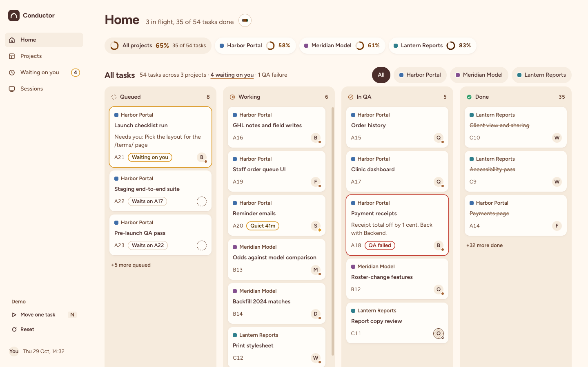

# orchestrate

A Claude Code skill that turns a finished implementation plan into a build run by several Claude
Code sessions at once. One orchestrator, one QA that only reports, and up to four implementer
lanes split by file ownership. Plus **Conductor**, a small local dashboard that shows every build
at a glance and lets you answer the orchestrator's questions from your browser.



## Why

Parallel Claude sessions break in the same few ways: two of them edit one file, "done" means "I
think it's done", nobody remembers anything after a compaction, and something irreversible
happens without you saying so. This setup comes from real builds that worked, and it fixes those:

- **Lanes never share files.** Tasks are grouped by the files they touch, and each lane owns its paths.
- **QA tests the exact commit** in its own copy of the code and never fixes anything itself. A task is done only when QA passes the commit that was handed in.
- **Checks are written first.** Every task gets 3-8 concrete checks with the evidence each needs, before anyone writes code. Most QA fails in past builds were a skipped requirement or missing proof, not a bug.
- **A breaker at the third QA fail.** No fourth round of the same approach: the orchestrator fixes the check, splits the task, or brings in a fresh look.
- **Files beat messages.** The board, decisions and lane notes live in files, so any session can pick back up after a compaction.
- **Gates only you open.** Deploys, live writes, real emails, pushes to main: the orchestrator prepares them and waits until you type "go".

## How a build looks

    you <-> <id>-orchestrator     assigns, decides, runs the gates; the only one who talks to you
              |- <id>-<lane>      implementers, one lane each, own files only
              '- <id>-qa          checks every task before it counts as done; never changes code

With a one-lane plan you get a **one-tab build** instead: a single orchestrator tab that starts a
builder helper per task and a separate read-only QA helper to review it. Same checks, same board,
same gates, fewer tabs to watch.

## Requirements

- Claude Code. Multi-tab builds need sessions that can message each other (`SendMessage`,
  `ListAgents`) and `/loop`. One-tab builds only need the Agent tool.
- Python 3 (stdlib only, no installs).
- macOS for the extras: Mac notifications, the launchd watchdog and the `Conductor.app` launcher.
  The board and the dashboard run anywhere Python does.

## Install

```sh
git clone https://github.com/uxieee/orchestrate-skill.git
cd orchestrate-skill
./install.sh
```

This copies the skill to `~/.claude/skills/orchestrate` and the two helper agents to
`~/.claude/agents/`. If you already have them, it stops. `./install.sh --replace` moves the old
copies aside (`*.bak-<timestamp>`) and installs. It never deletes anything.

## Use

Get a plan with a task list first (ids, titles, dependencies, the files each task touches).
Then, in Claude Code:

> orchestrate this

or "set up the sessions", "split this into lanes", "launch the build". The skill reads the plan,
proposes the lanes, gates and standing approvals in one short message, and **waits for your ok**.
Then it writes the project folder (`SESSIONS.md` or `SOLO.md`, `CHECKS.md`, `DECISIONS.md`, lane
notes and the board) and hands you one prompt per session, in start order. You open the tabs and
pick the models. The skill never chooses models for you.

## Conductor (the dashboard)

```sh
python3 conductor/server.py          # then open http://127.0.0.1:4747/
```

Or double-click `conductor/Conductor.command`, or run `conductor/build-app.sh` once to get a
`/Applications/Conductor.app` that starts it. Add `?demo` to the URL to see it with fake data.

It shows every registered build: progress, what each session is doing, which ones went quiet,
and what's waiting on you. You can answer decisions there. **Gates can't be opened from the
app**: only "go" typed in the orchestrator tab opens one.

It binds to `127.0.0.1` only, accepts changes only from its own page (Origin and Host checked,
so other websites can't answer for you), and never uploads anything. It finds builds through
`~/.conductor/projects.json`, which `board.py init` writes. Session liveness comes from Claude
Code's own status files in `~/.claude/sessions/`. That's best-effort: if Claude Code changes
that format, sessions show as closed. The board itself isn't affected.

Not affiliated with conductor.build.

## Pings (optional)

The orchestrator pings you when it needs a decision or a go, when a session is stuck, and when
the build finishes. Without setup you get Mac notifications only. For Telegram, create a bot with
@BotFather, then:

```sh
mkdir -p ~/.conductor
cat > ~/.conductor/telegram.env <<'EOF'
TELEGRAM_BOT_TOKEN=123456:your-bot-token
TELEGRAM_CHAT_ID=your-chat-id
EOF
chmod 600 ~/.conductor/telegram.env
```

Test it: `~/.claude/skills/orchestrate/scripts/notify.sh "test · finished" "Pings work."`
(exit 0 = Telegram sent, 3 = Mac only, 1 = nothing).

## Watchdog (optional)

The orchestrator's loop can stop (usage limits, a closed tab). The skill offers a watchdog that
pings you if its heartbeat goes quiet for 45 minutes. On a Mac it installs a launchd agent. On
Linux, add a cron line instead:

```sh
*/15 * * * * python3 ~/.claude/skills/orchestrate/scripts/board.py --docs "/abs/path/to/docs" watchdog
```

## What's in here

| Path | What |
|---|---|
| `skills/orchestrate/SKILL.md` | the skill: plan → lanes → project folder → hand-over |
| `skills/orchestrate/references/` | `SESSIONS.md` (multi-tab) and `SOLO.md` (one-tab) templates |
| `skills/orchestrate/scripts/board.py` | the board: locked JSON, refuses unsafe moves, shared test slots, stats |
| `skills/orchestrate/scripts/notify.sh` | Telegram + Mac notification |
| `agents/` | `orchestrate-builder` and `orchestrate-qa`, the one-tab helpers |
| `conductor/` | the dashboard: `server.py` + `ui/` |

`board.py --help` lists every command. `board.py stats` gives first-pass QA yield, fails per task and
fail classes for a build (`--all` for every build), so you can judge changes to the skill on
numbers, not impressions.

## License

MIT
